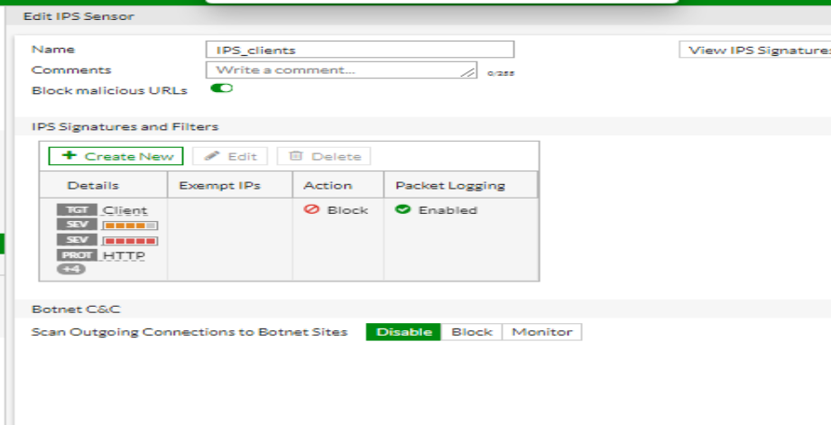
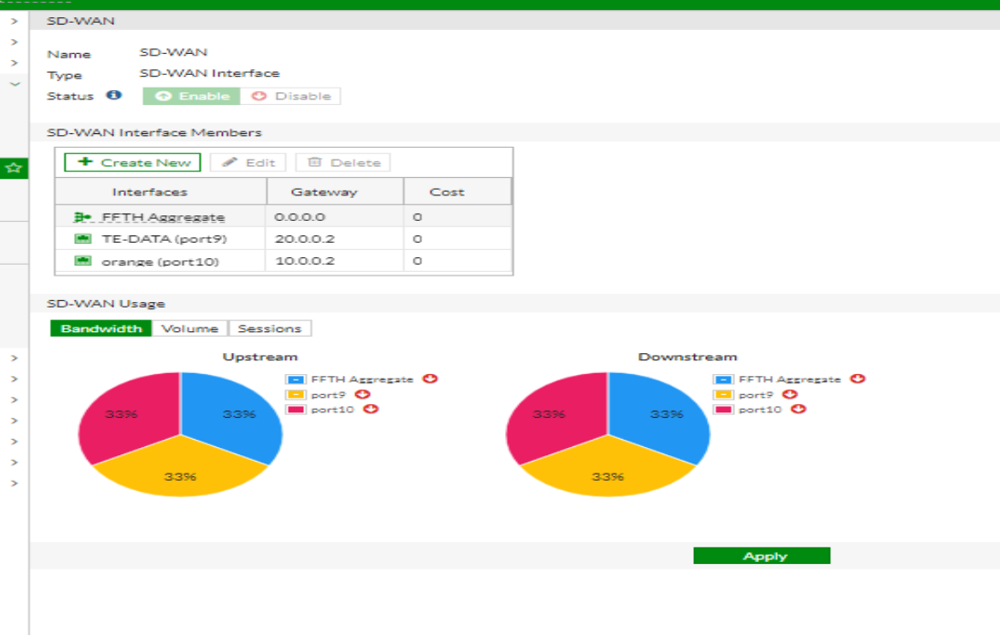

# FortiGate Enterprise Network Security | 50 Hands-on Tasks

**Engineer:** Malak Abdelaziz  
**Project Type:** Individual Hands-on Final Project  
**Technology:** Fortinet FortiGate Firewall  
**Scope:** 50 Practical Tasks

## Project Overview

This project demonstrates the design, configuration, and administration of a complete enterprise network security environment using Fortinet FortiGate Firewall.

I independently implemented 50 practical tasks as part of my FortiGate Firewall final project, integrating network infrastructure, firewall security, identity management, secure remote access, traffic optimization, and high availability into one system.

## Technologies & Features

### 1. Network Infrastructure
- LAN and WAN interface configuration
- VLANs and DHCP services
- IP reservations
- Link Aggregation
- Static Routing

#### Network Interfaces Configuration

**Implementation:**

Configured FortiGate LAN and WAN interfaces to establish connectivity between the internal network and external networks.

Implemented VLAN segmentation and DHCP services to organize network devices into separate logical networks and provide automatic IP address allocation.

**Purpose:** Establish a structured, manageable network infrastructure and support network segmentation.

### 2. Firewall Administration
- Firewall Policies and Address Objects
- NAT and Virtual IPs (DNAT)
- Policy-Based Routing
- Administrator Accounts, Access Profiles, and Trusted Hosts

#### Firewall Policies Configuration

**Implementation:**

Created firewall policies to control traffic between network segments and external networks.

Configured source and destination address objects, services, and security profiles to enforce access control requirements.

**Purpose:** Apply controlled network access and reduce unauthorized communication.

### 3. Authentication & Access Control
- LDAP integration with Windows Server
- User Groups
- Captive Portal Authentication

### 4. Security Profiles
- Antivirus
- Web Filtering and Quotas
- Application Control
- Intrusion Prevention System (IPS)
- SSL Deep Inspection and Certificate Configuration
- 

#### Web Filtering Configuration

**Implementation:**

Configured Web Filtering policies to control access to website categories and apply browsing restrictions.

Integrated Web Filtering profiles with firewall policies to enforce organizational browsing policies.

**Purpose:** Improve web access security and control access to restricted websites.

#### IPS Configuration

**Implementation:**

Configured Intrusion Prevention System (IPS) profiles to inspect network traffic for known attack patterns and suspicious activity.

Applied IPS profiles to relevant firewall policies to strengthen network protection.

**Purpose:** Detect and prevent network-based threats.

### 5. Traffic Management & SD-WAN
- Traffic Shaping and Bandwidth Management
- Multi-ISP SD-WAN Configuration
- Performance SLA and SLA Rules
- Application Steering and Load Balancing

#### SD-WAN Configuration

**Implementation:**

Configured multiple WAN connections using FortiGate SD-WAN.

Implemented Performance SLA monitoring and SD-WAN rules for traffic steering and WAN link selection.

**Purpose:** Improve WAN connectivity management, traffic distribution, and network availability.

### 6. VPN & Secure Connectivity
- SSL-VPN
- IPsec Site-to-Site VPN

### 7. High Availability & Automation
- High Availability (Active-Passive)
- Security Fabric Automation
- Email Alerts for Critical Events
- Encrypted Configuration Backup

#### High Availability (Active-Passive)

**Implementation:**

Configured FortiGate High Availability in Active-Passive mode using Primary and Secondary firewall units.

Established an HA cluster to provide firewall redundancy.

**Purpose:** Reduce the risk of a single firewall failure interrupting network connectivity.

## Project Screenshots

Configuration screenshots covering the project's major components are available in the [Screenshots Folder](screenshots/).

## Key Learning Outcomes

Through this project, I strengthened my practical skills in FortiGate firewall administration, network segmentation, identity-based access control, security policies, VPN connectivity, network availability, and troubleshooting.

## Testing & Validation

The configured network environment was tested throughout the project to verify connectivity, firewall policy behavior, user authentication, and the operation of implemented security features.

The project was completed independently as a practical final assessment covering 50 integrated FortiGate configuration tasks.

## Author

**Malak Abdelaziz**  
IT Support Specialist | Aspiring Network Security Engineer
